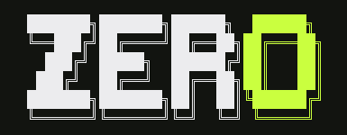

<p align="center">
  
</p>

<p align="center"><strong>IA QUE TRABALHA COM VOCE</strong></p>

<p align="center">
  <a href="LICENSE"></a>
  
</p>

# QG — Quebra-Galho

O QG (Quebra-Galho) é um agente de codificação de terminal que roda na sua
máquina. Ele inspeciona repositórios, edita arquivos, executa comandos, usa
helpers de navegador/terminal e mantém sessões locais duráveis — enquanto você
escolhe o modelo e o nível de permissão.

```bash
qg
qg exec "corrige o teste que falhou em ./pkg"
qg exec --output-format stream-json < turns.jsonl
```

## Por que o QG

- **Um único gateway.** Todos os modelos vêm do gateway Quebra Galho, com
  catálogo curado atrás da sua chave (`QG_API_KEY`). Sem provedores para
  configurar.
- **Você no controle.** Escritas de arquivo, comandos de shell, acesso à rede
  e escritas fora do workspace passam pela política de permissões e sandbox do
  QG.
- **No terminal.** A TUI tem seletor de modelos, comandos slash, renderização
  ao vivo de planos e ferramentas, scrollback, temas e retomada de sessões.
- **Sem TUI também.** `qg exec` é scriptável, com I/O texto/JSON/stream-JSON,
  worktrees isolados, execuções spec-first e códigos de saída úteis para CI.
- **Contexto local.** Sessões ficam gravadas em disco, pesquisáveis e
  retomáveis — nunca enviadas como telemetria.
- **Extensível.** MCP, skills, plugins, hooks e subagentes especialistas pelo
  mesmo CLI.

## Instalação

Os fontes exigem Go 1.26.6+. O jeito mais direto de rodar agora é compilar
localmente:

```bash
git clone https://github.com/quebragalho-dev/quebragalho-cli.git
cd quebragalho-cli
go build -o qg ./cmd/qg
./qg
```

Coloque o binário `qg` num diretório do `PATH` (`~/.local/bin` é uma boa
escolha) para usá-lo de qualquer lugar. No Linux, build também o helper de
sandbox se quiser sandbox nativo:

```bash
go build -o qg-linux-sandbox ./cmd/qg-linux-sandbox
```

Também é publicado como pacote npm (`npm install -g @quebragalho-dev/qg`),
que instala **os dois nomes de comando**: `qg` e o alias `quebragalho`.

## Primeiros passos

1. **Tenha a sua chave do Quebra Galho.** Ela começa com `sk-...`.

2. **Escolha um dos caminhos para salvar a chave:**

   ```bash
   # caminho rápido (valida a chave contra o gateway e grava no cofre):
   qg login
   # ou, com a chave no ambiente antes de qualquer comando:
   export QG_API_KEY=sk-...
   ```

   `qg login` grava a chave no cofre de credenciais criptografado do seu usuário; a configuração
   guarda apenas o marcador `apiKeyStored`, nunca o valor.

3. **Rode o QG:**

   ```bash
   qg
   ```

   - **Sem chave / sem configuração**, a primeira execução abre o
     **onboarding de 3 telas**: (a) boas-vindas Quebra Galho, (b) colar a
     chave (`QG_API_KEY` ou `QUEBRAGALHO_API_KEY`) com validação em
     `GET /v1/models`, (c) escolher o modelo — com
     `muse-spark-1.3-contributor` já pré-selecionado.
   - Para regravar só a chave depois, `qg login` refaz a validação sem
     tocar no resto da configuração.

4. **Ou configure via linha de comando:**

   ```bash
   qg setup qg
   ```

## Modelos

- O gateway Quebra Galho serve **19 modelos** no catálogo QG; `qg models`
  lista todos com contexto e descrição.
- O modelo padrão é **`muse-spark-1.3-contributor`**.
- A validação da chave e a descoberta de modelos falam com `GET /v1/models`
  do gateway.
- Troque o modelo a qualquer momento com `/model` na TUI ou `qg exec
  --model <id>` na linha de comando.

## Comandos principais

| Comando | O que faz |
|---|---|
| `qg` | abre a TUI interativa |
| `quebragalho` | alias do mesmo binário (instalado via npm) |
| `qg login` | valida e salva a sua chave Quebra Galho |
| `qg setup qg` | configura o provedor QG pela linha de comando |
| `qg models` | lista os 19 modelos do registro QG |
| `qg providers` | mostra os perfis de provedor resolvidos |
| `qg exec "..."` | execução única ou scriptável do agente |
| `qg doctor` | verifica configuração, chave e conectividade |
| `qg sessions` | inspeciona, retoma, bifurca e rebobina sessões |
| `qg --help` | a lista completa de comandos e flags |

## Uso diário

### TUI interativa

```bash
qg
```

Controles úteis:

| Controle | Ação |
|---|---|
| `Enter` | envia o prompt |
| `/` | abre as sugestões de comandos slash |
| `Ctrl+X` depois de uma letra | comandos slash comuns (`m` → `/model`; `Ctrl+X` `?` para a lista) |
| `Ctrl+P` / `Ctrl+N` | item anterior / próximo nos menus (setas também funcionam) |
| `Shift+Tab` | alterna o modo de permissão |
| `Ctrl+B` | mostra/oculta a barra lateral |
| `Ctrl+C` | cancela, sai, ou volta de uma conversa `/btw` |

Comandos slash mais usados:

| Comando | Propósito |
|---|---|
| `/model` | troca o modelo ativo |
| `/spec`, `/plan` | esboça e revisa um plano antes de construir |
| `/image` | anexa uma imagem para modelos com visão |
| `/resume`, `/rewind` | continua ou rebobina sessões locais |
| `/new` | começa uma sessão nova no lugar (a anterior fica no disco) |
| `/btw [pergunta]` | perguntas em um fork isolado, sem poluir a sessão principal |
| `/loop` | repete um prompt ou `/command` num intervalo (`/loop 5m /babysit-prs`) ou no seu ritmo |
| `/compact`, `/context` | gerencia o uso de contexto |
| `/permissions`, `/tools` | inspeciona as ferramentas disponíveis e a política |
| `/add-dir` | libera um diretório extra de escrita para a sessão |
| `/theme`, `/doctor`, `/config` | ajusta aparência e inspeciona a configuração |

### Exec headless

```bash
qg exec "explica internal/agent/loop.go"
qg exec --model muse-spark-1.3-contributor "refatora o carregador de config"
qg exec --use-spec "adiciona rate limiting no cliente da API"
qg exec --worktree "testa a migração num worktree isolado"
qg exec --resume
qg exec --fork <session-id> "tenta a outra abordagem"
```

Uso programático com streaming:

```bash
qg exec --input-format stream-json --output-format stream-json < turns.jsonl
```

O contrato de stream-JSON está documentado em
[docs/STREAM_JSON_PROTOCOL.md](docs/STREAM_JSON_PROTOCOL.md).

## Modelo de segurança

O QG é feito para deixar efeitos colaterais visíveis.

- Leituras do workspace são permitidas por padrão.
- Escritas de arquivo ficam limitadas ao workspace, a menos que você conceda
  outro diretório.
- Comandos de shell, acesso à rede, comandos destrutivos e ações elevadas
  passam por permissão.
- `--add-dir <caminho>` e `/add-dir <caminho>` concedem raízes extras de
  escrita sem entregar o filesystem inteiro ao agente.
- Modos inseguros/autônomos são opt-in explícito.
- Segredos são redigidos da saída de ferramentas e dos logs onde o QG
  controla a superfície.

Exemplo:

```bash
qg --add-dir ../docs-site
qg exec --add-dir ../shared "atualiza os dois repositórios"
```

O comportamento do sandbox pode ser inspecionado com:

```bash
qg sandbox policy
qg sandbox grants list
```

## Web e controle local

O QG inclui as ferramentas locais de arquivo/busca/edição/shell, `web_fetch`
para URLs públicas e suporte a MCP para ferramentas adicionais.

`web_fetch` recusa endereços loopback, privados e de uso especial: verifica a
URL antes de pedir permissão, resolve o host e conecta no endereço que
validou, para que um nome não resolva para outra coisa no meio do caminho.

Se `HTTP_PROXY`/`HTTPS_PROXY` estiver definido, `web_fetch` e a checagem de
conectividade do gateway o utilizam; nesse último passo o proxy é conectado e
o hostname do destino é enviado a ele, então o proxy decide qual endereço a
requisição alcança. A URL ainda é verificada e resolvida localmente primeiro,
mas um proxy que responda de forma diferente pode alcançar um serviço privado.
Um proxy de encaminhamento já vê e pode reescrever toda requisição por ele —
essa é a confiança que você aceita ao configurar um. Deixe as variáveis sem
definição para valerem as verificações de ponta a ponta.

Para servidores de dev locais, use comandos de shell como `curl` através do
`exec_command` para que a política normal de sandbox e permissões se aplique.
Comandos de longa duração ficam anexados a uma sessão de terminal de fundo e
podem ser listados ou parados pela TUI.

## Estendendo o QG

### Instruções de projeto e pessoais

O QG acrescenta orientações específicas do projeto ao prompt de sistema a
partir do primeiro arquivo `AGENTS.md`, `QG.md` ou `.qg/AGENTS.md` encontrado
em cada diretório, da raiz do git até o seu diretório atual (nessa ordem por
diretório). Os arquivos são injetados do mais geral para o mais específico,
com limite de 8 KiB por arquivo e 32 KiB no total.

Um `QG.md` pessoal em `config.UserConfigDir()/qg/QG.md`
(`$XDG_CONFIG_HOME/qg/QG.md` ou `~/.config/qg/QG.md` no Linux/macOS,
`%AppData%\Roaming\qg\QG.md` no Windows) vale em todo workspace, à frente de
qualquer orientação de projeto.

### Plugins

Plugins são descobertos em `~/.config/qg/plugins/<nome>/plugin.json` (escopo
pessoal) e `<cwd>/.qg/plugins/<nome>/plugin.json` (escopo de projeto), e são
gerenciados com `qg plugins`. O manifesto pode declarar:

- `tools` — ferramentas próprias (`command`, `args`, `inputSchema` e uma
  `permission` de `prompt` ou `deny`)
- `hooks` — comandos executados em `beforeTool`, `afterTool`, `sessionStart`
  ou `sessionEnd`
- `prompts` e `skills` — arquivos de prompt/skill adicionais

Servidores MCP (`qg mcp`) e skills em markdown (`qg skills`) usam os mesmos
pontos de extensão e também podem ser ligados fora de um manifesto de plugin.

## Aparência e acessibilidade

| Controle | Efeito |
|---|---|
| `NO_COLOR=<qualquer>` | desativa a saída colorida |
| `QG_THEME=<nome>` | escolhe o tema inicial (`auto`, `dark`, `light` ou um tema de cor como `dracula`, `nord`, `gruvbox`, `tokyo-night`, `catppuccin`, `one-dark`, `solarized-dark`, `rose-pine`, `everforest`, `neon`, `solarized-light`, `dune`) |
| `--theme <nome>` | escolhe o tema da TUI pela CLI (mesmos nomes) |
| `/theme` | abre o seletor de temas dentro da TUI (pré-visualização ao vivo; `/theme <nome>` troca direto) |
| `QG_NO_FADE=1` | desativa a animação de fade do streaming |

O significado não depende só de cor; diffs, permissões e status também usam
marcadores de texto ou glifos.

## Desenvolvimento

```bash
go test ./...
go run ./cmd/qg-release build
go run ./cmd/qg-release smoke
go run ./cmd/qg-perf-bench
```

### Qualidade de código e checagens de segurança

Antes de commitar, garanta que todas as checagens de qualidade e segurança do
código Go passem. Os alvos do `make` abaixo fixam cada ferramenta à versão
de Go deste módulo, então carregam corretamente mesmo que o seu `go` padrão
seja mais antigo.

1. **Formatação**: rode `make fmt` (ou `go fmt ./...`).
2. **Vet**: rode `make vet` (ou `go vet ./...`).
3. **Lint**: rode `make lint-static`.
4. **Varredura de vulnerabilidades**: rode `make vulncheck`.

Use os alvos do repositório em vez de binários instalados globalmente: eles
aplicam o toolchain de Go gerenciado pelo módulo e as versões revisadas e
presas das ferramentas.

### Exemplos de cross-compile

```bash
go run ./cmd/qg-release build --goos linux --goarch amd64
go run ./cmd/qg-release build --goos windows --goarch amd64 --output dist/qg.exe
```

## Documentação

- [Instalação](docs/INSTALL.md)
- [Fluxo de atualização](docs/UPDATE.md)
- [Temas](docs/THEMES.md)
- [Protocolo stream-JSON](docs/STREAM_JSON_PROTOCOL.md)
- [Especialistas](docs/SPECIALISTS.md)
- [GitHub Action](docs/GITHUB_ACTION.md)
- [Benchmarks](docs/BENCHMARK.md)
- [Performance](docs/PERFORMANCE.md)
- [Evals de agente](docs/AGENT_EVALS.md)

## Comunidade

Dúvidas, ajuda de configuração, ideias e compartilhamento vivem no
[GitHub Discussions](https://github.com/quebragalho-dev/quebragalho-cli/discussions):

| Categoria | Use para |
|---|---|
| [Q&A](https://github.com/quebragalho-dev/quebragalho-cli/discussions/categories/q-a) | Ajuda de setup, configuração, perguntas de "como faço" |
| [Ideias](https://github.com/quebragalho-dev/quebragalho-cli/discussions/categories/ideas) | Propostas de feature e discussão de design antes de qualquer PR |
| [Show and tell](https://github.com/quebragalho-dev/quebragalho-cli/discussions/categories/show-and-tell) | Suas skills, plugins, MCPs, temas e workflows |
| [Anúncios](https://github.com/quebragalho-dev/quebragalho-cli/discussions/categories/announcements) | Releases e notícias oficiais |

Para ter uma resposta rápida no Q&A, inclua `qg --version`, seu SO e método de
instalação, o modelo em uso e a saída do `qg doctor`. Veja [SUPPORT.md](SUPPORT.md).
Bugs vão para as [issues](https://github.com/quebragalho-dev/quebragalho-cli/issues/new/choose);
relatórios de segurança seguem [SECURITY.md](SECURITY.md), nunca um thread
público.

## Contribuindo

Contribuições são bem-vindas. Leia [CONTRIBUTING.md](CONTRIBUTING.md), rode os
testes relevantes e abra um pull request focado.

Relatórios de segurança devem seguir [SECURITY.md](SECURITY.md).

## Créditos

O QG é um fork/rebrand do [Zero](https://github.com/Twigpine/zero), de
Twigpine.

## Licença

O QG é distribuído sob a [Licença MIT](LICENSE).
