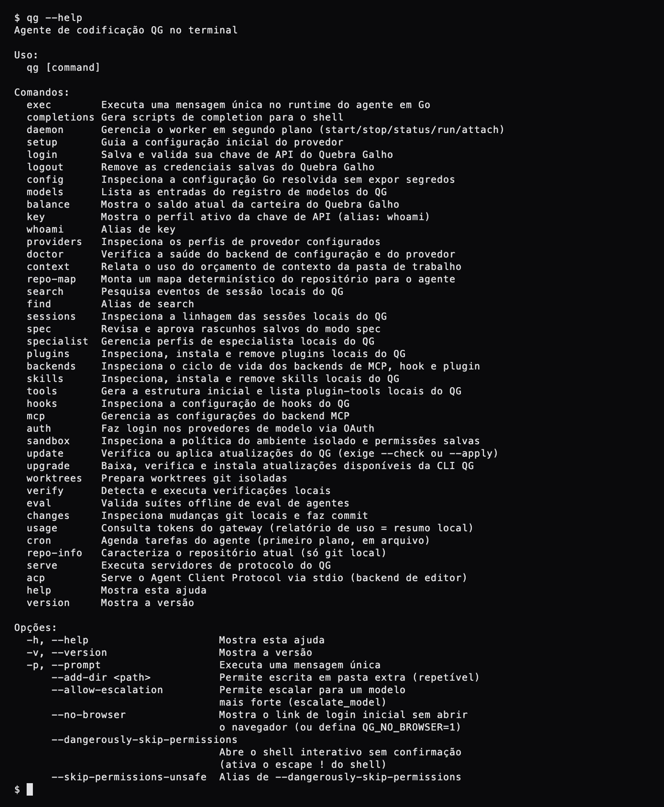
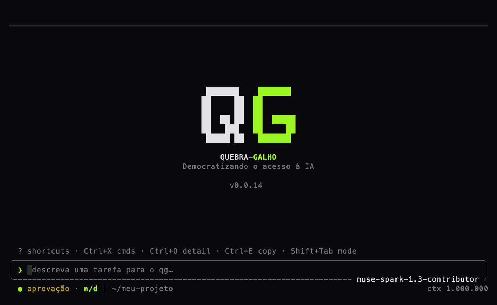
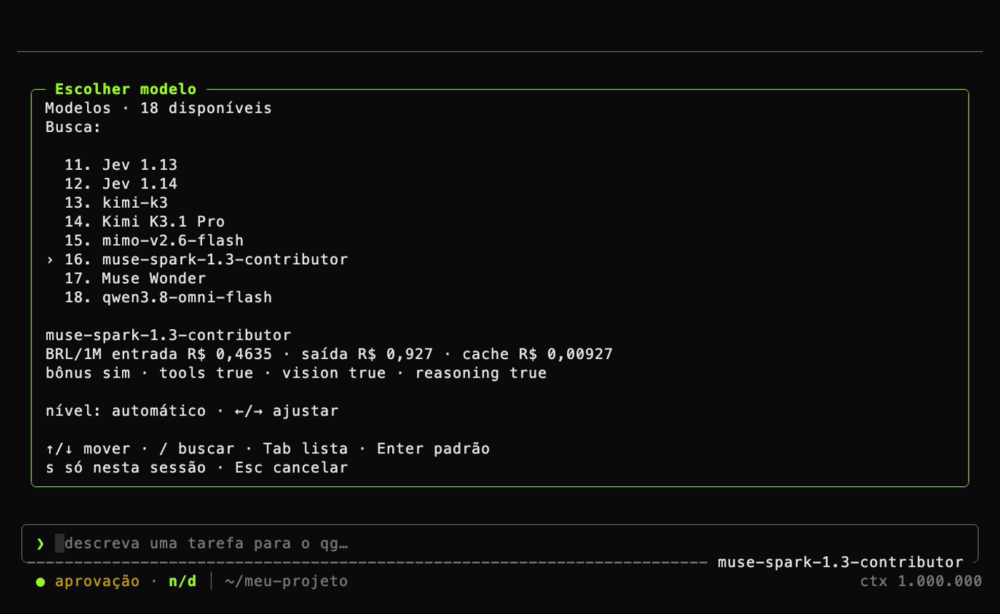
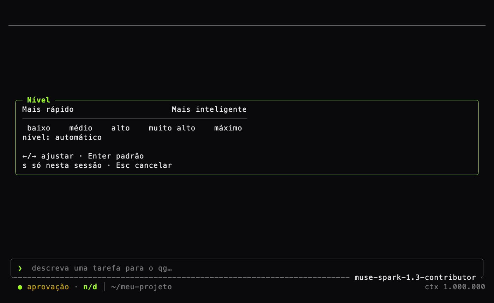
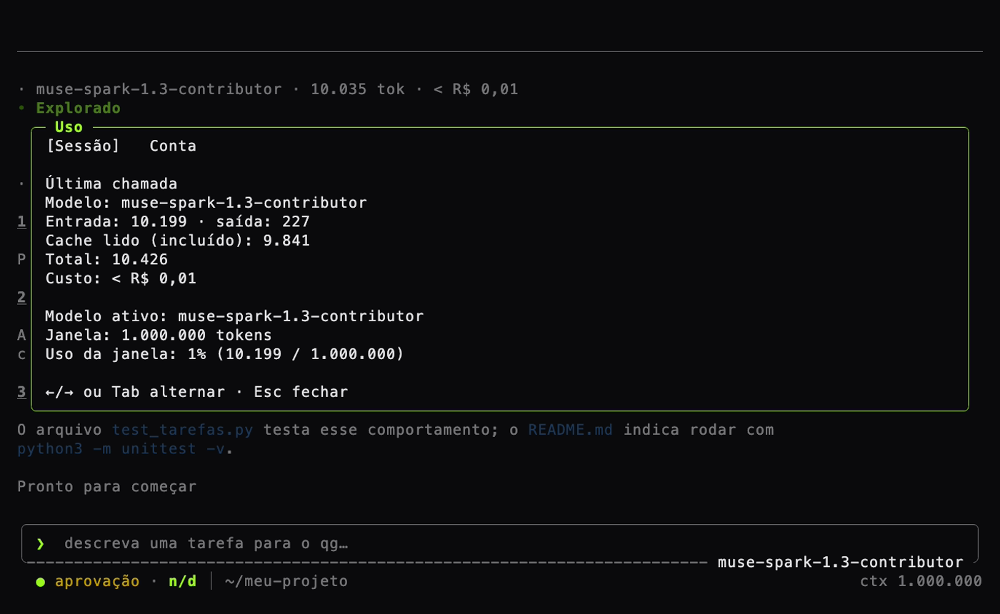
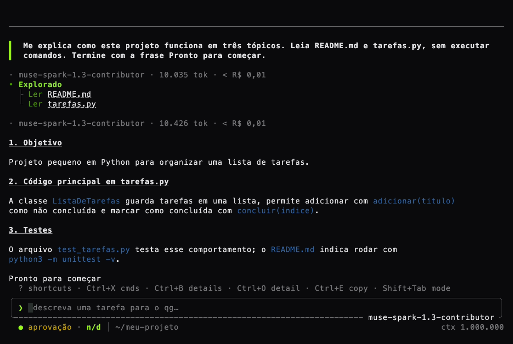
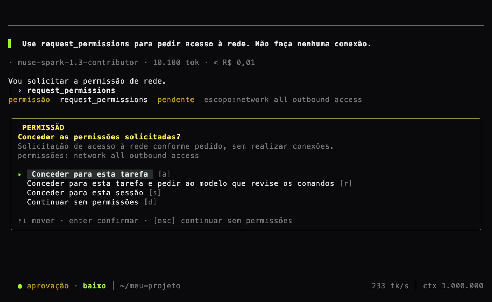

<p align="center">
  
</p>

# Quebra-Galho

**Democratizando o acesso à IA.**

O QG é uma ajuda para programar direto no terminal. Você pede o que precisa,
ele lê o projeto, propõe mudanças, edita arquivos e roda comandos. Você escolhe
o modelo e acompanha o que está acontecendo.

Dá para começar com uma pergunta simples:

```text
Me explica como este projeto funciona.
```

Ou pedir uma tarefa concreta:

```text
Encontre o motivo do teste que falhou e corrija o problema.
```

## Instalação

Pelo npm (Linux, macOS e Windows com Node 18+):

```bash
npm install -g @quebragalho/cli
qg
```

No Linux ou macOS, também dá pelo script:

```bash
curl -fsSL https://raw.githubusercontent.com/quebragalho-dev/quebragalho-cli/main/scripts/install.sh | bash
qg
```

No Windows, use o PowerShell:

```powershell
irm https://raw.githubusercontent.com/quebragalho-dev/quebragalho-cli/main/scripts/install.ps1 | iex
qg
```

Se o PowerShell disser que o `qg.ps1` "não pode ser carregado porque a
execução de scripts foi desabilitada", use `qg.cmd` no lugar de `qg`
(ou rode pelo `cmd`), ou libere scripts locais com
`Set-ExecutionPolicy -Scope CurrentUser RemoteSigned`.

Há binário nativo para ARM64, incluindo Windows. Para escolher uma versão
no Linux ou macOS, substitua `vX.Y.Z` pela versão desejada:

```bash
curl -fsSL https://raw.githubusercontent.com/quebragalho-dev/quebragalho-cli/main/scripts/install.sh | bash -s -- --version vX.Y.Z
```

Veja mais opções no [guia de instalação](docs/INSTALL.md).

## Atualizar

O qg avisa ao abrir quando sai versão nova. Dá para instalar na hora,
pular, ler o changelog ou sair.

```bash
qg upgrade
```

`qg update --check` só confere, sem instalar. Para desligar o aviso
automático, use `QG_NO_UPDATE_CHECK=1`. Detalhes no
[guia de atualização](docs/UPDATE.md).

## Primeiros passos

1. Abra o terminal na pasta do seu projeto e rode `qg`.
2. Na primeira abertura, entre com o navegador ou cole sua chave do Quebra Galho e escolha um modelo.
3. Escreva seu pedido e pressione Enter.

Para trocar ou cadastrar a chave depois, use `qg login` (ou `qg login --device`
para aprovar o acesso no navegador em vez de colar a chave). Se algo não funcionar,
`qg doctor` ajuda a conferir a configuração e a conexão.

### Login e chave

Se não houver login salvo, `qg` (ou `quebragalho`) abre uma tela de entrada que usa o
navegador: o CLI abre a página de aprovação, mostra o link e um código curto, e
depois de aprovar vai direto para a escolha do modelo e para o chat. Para colar uma
chave de API, use Tab nessa tela. Nas próximas vezes, `qg` abre direto no chat.

- `/logout` (dentro do TUI) ou `qg logout` remove a chave salva, qualquer chave inline
  e tokens OAuth antigos. O perfil é mantido. Se `QG_API_KEY` ou `QUEBRAGALHO_API_KEY`
  estiverem definidas, remova-as você mesmo para o logout valer.
- `--no-browser` (em `qg` e em `qg login --device`) desativa a abertura automática do
  navegador, útil em SSH ou sem interface gráfica. O link e o código continuam sendo
  mostrados. Na abertura interativa, `QG_NO_BROWSER=1` tem o mesmo efeito.
- Precedência da chave: chave inline do perfil (e `qg exec --api-key`, só naquela
  execução) > `QG_API_KEY` / `QUEBRAGALHO_API_KEY` > chave salva.

## No dia a dia

| Comando | Para quê |
| --- | --- |
| `/model` | Escolher outro modelo. |
| `/effort` | Ajustar a preferência de esforço do modelo. |
| `/usage` | Ver tokens, contexto, custo e dados da conta. |
| `/plan` | Planejar uma mudança antes de executá-la. |
| `/resume` | Continuar uma conversa salva. |
| `/new` | Começar outra conversa, mantendo a anterior salva. |
| `/permissions` | Conferir as permissões da sessão. |
| `/help` | Ver os outros comandos. |

Para voltar a uma conversa depois de fechar o terminal, anote o id mostrado
na saída (`Para continuar: qg --continue <id>`):

```bash
qg --continue            # sessão mais recente desta pasta
qg --continue <id>       # aquela sessão (-c é o atalho)
qg --resume              # escolhe numa lista (igual a /resume sem id)
qg --resume <id>         # aquela sessão
```

O retorno volta exatamente aonde estava: a conversa, o modelo e o esforço
são restaurados e o turno seguinte continua do histórico real, sem resumo.

Nos painéis de modelo e esforço, Enter salva a escolha como padrão, `s` aplica
só na sessão e Esc cancela. Use Shift+Tab para alternar o modo de permissão.

Também dá para fazer um pedido sem abrir a interface:

```bash
qg exec "Explique os testes deste projeto"
```

`qg models` lista os modelos disponíveis. `qg --help` mostra os comandos do
terminal, incluindo as opções para usar o QG em scripts.

## Veja funcionando

Capturas do qg 0.0.14 num terminal comum. Tokens e custos variam conforme
o modelo e o pedido.

**Ajuda no terminal**

Os comandos do qg sem sair do shell.



**Tela inicial**

A entrada do qg na pasta do projeto.



**Escolha de modelo**

O painel de modelos em português.



**Preferência de esforço**

O painel de esforço em português.



**Uso da sessão**

Tokens, contexto e custo da sessão.



**Uma conversa curta**

Uma resposta do qg com o recibo da chamada.



**Pedido de permissão**

O qg pede antes de alterar arquivos ou rodar comandos.



A velocidade aparece em `tk/s` quando há medição real. O total de tokens fica
no recibo, ao lado do custo. Na statusline, quando o contexto usa uma referência local,
aparece a indicação `fallback/docs`. Os detalhes estão no
[guia de telemetria da interface](docs/TUI_TELEMETRY.md).

## Segurança

O QG pode alterar arquivos e executar comandos. Revise os pedidos de permissão
e confira as mudanças antes de incorporá-las ao seu projeto.

- Cada sistema isola os comandos do agente: Seatbelt no macOS, bwrap no Linux
  e o ambiente isolado do Windows. `qg doctor` confere se o isolamento está ativo.
- Use `/permissions` para entender o que a sessão pode fazer.
- Para permitir escrita em outra pasta, use `--add-dir <pasta>` ou `/add-dir <pasta>`.
- `--dangerously-skip-permissions` ativa o modo inseguro, dispensa aprovações e
  pode desativar proteções do ambiente. O nome antigo, `--skip-permissions-unsafe`,
  continua funcionando como alias.
- Não inclua chaves de API em mensagens, capturas de tela ou arquivos do projeto.

As conversas ficam salvas localmente. O conteúdo necessário para responder ao
pedido é enviado ao modelo que você escolheu. Para relatar uma falha de
segurança, siga [SECURITY.md](SECURITY.md).

## Quer ir além?

- [Instalar e atualizar](docs/INSTALL.md)
- [O que mudou em cada versão](CHANGELOG.md)
- [Mudar o tema](docs/THEMES.md)
- [Adicionar skills, ferramentas e integrações](docs/EXTENDING.md)
- [Usar o QG no seu código (SDK TypeScript e Python)](sdk/README.md)
- [Pedir ajuda](SUPPORT.md)
- [Contribuir com o projeto](CONTRIBUTING.md)

<p align="center">
  
</p>

Distribuído sob a [licença MIT](LICENSE).
