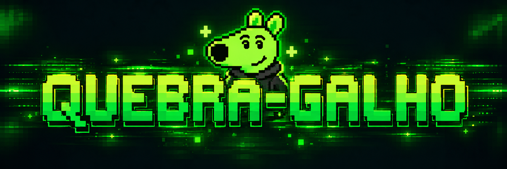
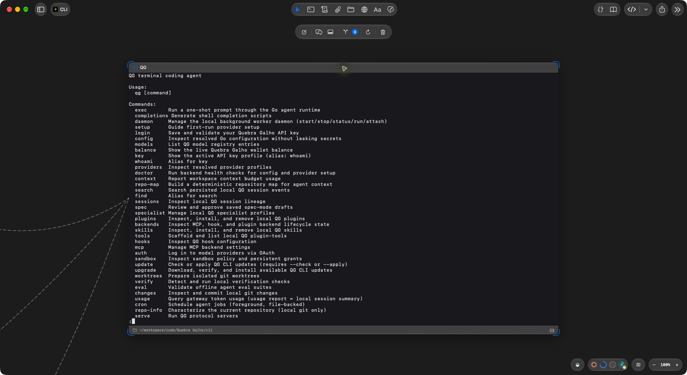
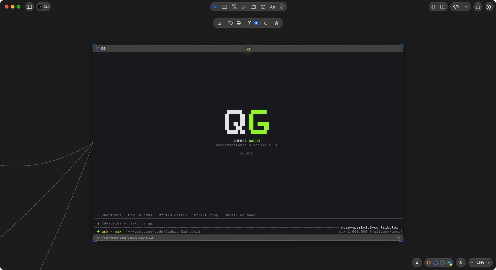
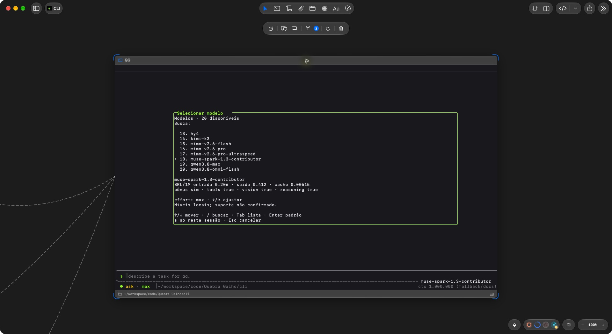
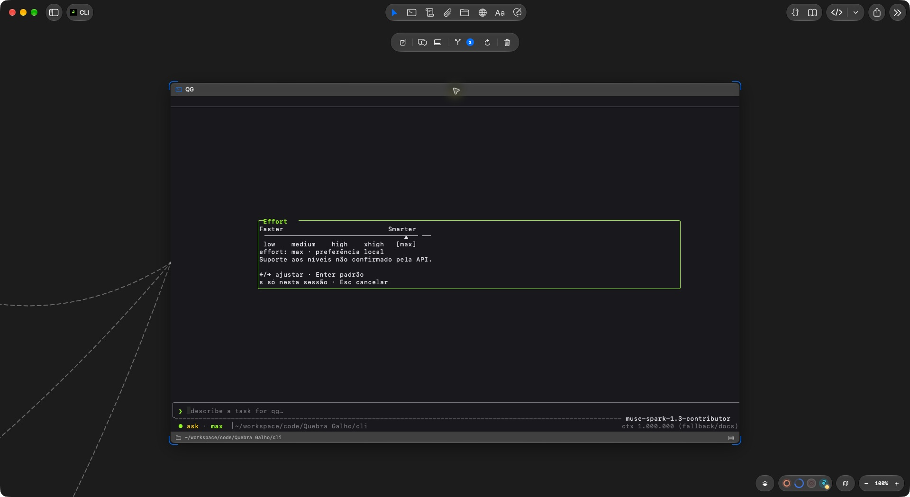
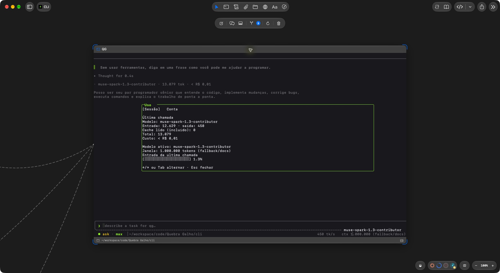
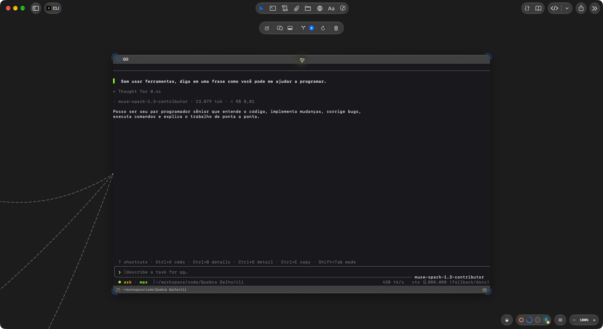

<p align="center">
  
</p>

# Quebra-Galho

**Democratizando o acesso à IA.**

O QG é uma ajuda para programar direto no terminal. Você pede o que precisa,
ele lê o projeto, propõe mudanças, edita arquivos e roda comandos. Você escolhe
o modelo e acompanha o que está acontecendo.

Dá para começar com uma pergunta simples:

```text
Me explica como este projeto funciona.
```

Ou pedir uma tarefa concreta:

```text
Encontre o motivo do teste que falhou e corrija o problema.
```

## Instalação

No Linux ou macOS, instale pelo mirror público e abra o QG:

```bash
curl -fsSL https://raw.githubusercontent.com/quebragalho-dev/qg-releases/main/scripts/install.sh | bash
qg
```

No Windows, use o PowerShell:

```powershell
irm https://raw.githubusercontent.com/quebragalho-dev/qg-releases/main/scripts/install.ps1 | iex
qg
```

Para escolher uma versão no Linux ou macOS, substitua `vX.Y.Z` pela versão desejada:

```bash
curl -fsSL https://raw.githubusercontent.com/quebragalho-dev/qg-releases/main/scripts/install.sh | bash -s -- --version vX.Y.Z
```

Veja mais opções no [guia de instalação](docs/INSTALL.md).

## Primeiros passos

1. Abra o terminal na pasta do seu projeto e rode `qg`.
2. Na primeira abertura, informe sua chave do Quebra Galho e escolha um modelo.
3. Escreva seu pedido e pressione Enter.

Para trocar ou cadastrar a chave depois, use `qg login`. Se algo não funcionar,
`qg doctor` ajuda a conferir a configuração e a conexão.

## No dia a dia

| Comando | Para quê |
| --- | --- |
| `/model` | Escolher outro modelo. |
| `/effort` | Ajustar a preferência de esforço do modelo. |
| `/usage` | Ver tokens, contexto, custo e dados da conta. |
| `/plan` | Planejar uma mudança antes de executá-la. |
| `/resume` | Continuar uma conversa salva. |
| `/new` | Começar outra conversa, mantendo a anterior salva. |
| `/permissions` | Conferir as permissões da sessão. |
| `/help` | Ver os outros comandos. |

Nos painéis de modelo e esforço, Enter salva a escolha como padrão, `s` aplica
só na sessão e Esc cancela. Use Shift+Tab para alternar o modo de permissão.

Também dá para fazer um pedido sem abrir a interface:

```bash
qg exec "Explique os testes deste projeto"
```

`qg models` lista os modelos disponíveis. `qg --help` mostra os comandos do
terminal, incluindo as opções para usar o QG em scripts.

## Veja funcionando

Capturas do executável compilado deste projeto. A conversa é uma chamada curta
de demonstração. Tokens e custos variam conforme o modelo e o pedido.

**Ajuda no terminal**



**Tela inicial**



**Escolha de modelo**



**Preferência de esforço**



**Uso da sessão**



**Uma conversa curta**



A velocidade aparece em `tk/s` quando há medição real. O total de tokens fica
no recibo, ao lado do custo. Na statusline, quando o contexto usa uma referência local,
aparece a indicação `fallback/docs`. Os detalhes estão no
[guia de telemetria da interface](docs/TUI_TELEMETRY.md).

## Segurança

O QG pode alterar arquivos e executar comandos. Revise os pedidos de permissão
e confira as mudanças antes de incorporá-las ao seu projeto.

- Use `/permissions` para entender o que a sessão pode fazer.
- Para permitir escrita em outra pasta, use `--add-dir <pasta>` ou `/add-dir <pasta>`.
- `--dangerously-skip-permissions` ativa o modo inseguro, dispensa aprovações e
  pode desativar proteções do ambiente. O nome antigo, `--skip-permissions-unsafe`,
  continua funcionando como alias.
- Não inclua chaves de API em mensagens, capturas de tela ou arquivos do projeto.

As conversas ficam salvas localmente. O conteúdo necessário para responder ao
pedido é enviado ao modelo que você escolheu. Para relatar uma falha de
segurança, siga [SECURITY.md](SECURITY.md).

## Quer ir além?

- [Instalar e atualizar](docs/INSTALL.md)
- [Mudar o tema](docs/THEMES.md)
- [Adicionar skills, ferramentas e integrações](docs/EXTENDING.md)
- [Pedir ajuda](SUPPORT.md)
- [Contribuir com o projeto](CONTRIBUTING.md)

<p align="center">
  
</p>

Distribuído sob a [licença MIT](LICENSE).
